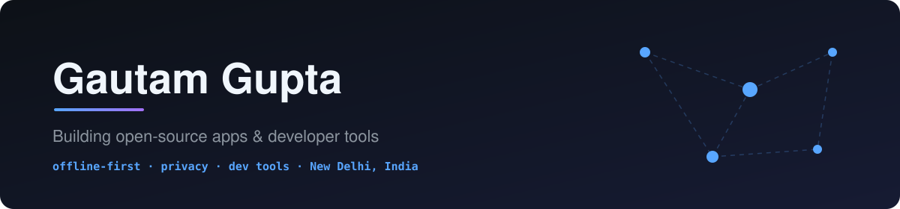

  
  
  
  
  

---

### ⭐ Featured: MeshLive

<h2><a href="https://github.com/MeshLive">📡 MeshLive</a></h2>

<b>Encrypted voice &amp; video calls and live streams between phones over a Bluetooth mesh.</b> 
No internet, no SIM, no servers. Built for internet shutdowns, disasters and off-grid use.

  

 

  

### 🛠️ More projects

<table>
  <tr>
    <td width="50%" valign="top">
      <h3><a href="https://github.com/gautamgpt1/agent-session-browser">🗂️ Agent Session Browser</a></h3>
      Browse, filter, export and resume your local <b>Claude Code, Codex, Gemini CLI, Pi</b> and <b>Antigravity</b> sessions.
        
      
      
      
      
    </td>
    <td width="50%" valign="top">
      <h3><a href="https://github.com/gautamgpt1/TrenchHQ">📈 TrenchHQ</a></h3>
      Your crypto desktop companion for Windows: prices, wallet activity, X feeds and apps in view across all your monitors.
        
      
      
      
        
      
    </td>
  </tr>
</table>

### 🧰 Tech I work with

  

### ✍️ Latest posts

<!-- BLOG-POST-LIST:START -->
<!-- BLOG-POST-LIST:END -->

➡️ More on [dev.to](https://dev.to/gautamgpt1) and [Hashnode](https://meshlive.hashnode.dev)

### 🐍 Contributions

<picture>
  <source media="(prefers-color-scheme: dark)" srcset="https://raw.githubusercontent.com/gautamgpt1/gautamgpt1/output/snake-dark.svg">
  
</picture>

---

**If my work saves you time, a coffee keeps me shipping ☕**

  

